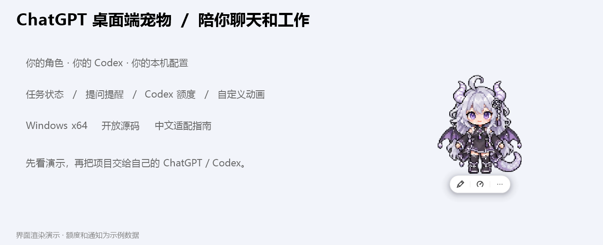
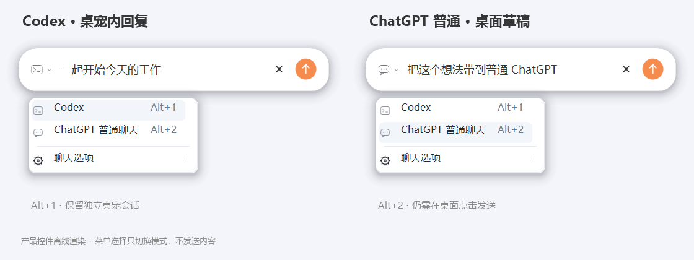
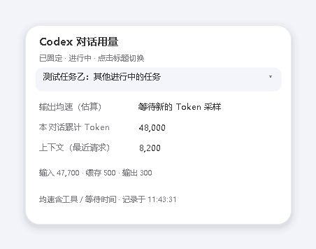

<div align="center">

# ChatGPT 桌面端宠物

### 让自己的角色，陪你聊天和完成任务

PetBridge · Windows 桌面宠物 · 任务与提问提醒 · Codex 额度 · 自定义角色

**v1.3.2** · Windows x64 / .NET Framework 4.8 · 代码 MIT · 独立社区项目

[开始使用](#开始使用) · [功能图鉴](docs/FEATURE-GALLERY.zh-CN.md) · [让 Codex 改角色](docs/CUSTOMIZE-CHARACTER.zh-CN.md)



</div>

任务进行时思考，需要你回答时提醒你，任务结束后弹出气泡。你可以换成自己的角色，也可以让能操作本机项目的 ChatGPT / Codex 帮你适配。

## 为什么做这个

起初使用官方宠物时，我觉得它还不够懂我的工作状态：我希望它能跟着任务思考、在需要回答时叫我、完成后告诉我，也能随手看一眼剩余额度。于是，我用 Codex 做了这个更贴合自己使用习惯的 ChatGPT 桌面端宠物，并把它整理成可以自己适配、自己换角色的开源项目。

> 图片由程序自己的界面代码离线渲染，额度与通知是示例数据。额度胶囊显示 **Codex 额度**；Codex 桌宠聊天是独立会话；普通 ChatGPT 目标通过桌面草稿继续。普通 ChatGPT 完成气泡默认关闭，Work / Codex 完成提醒默认保留。

## 先看角色动起来


默认“ChatGPT娘”采用灰黑与少量紫色。六组动作各 4 帧，另有 16 向注视。待机 2 fps、行走 4 fps；失败、等待和收尾复用基础动作，不要求每个角色都画齐。

<details>
<summary>展开：慢速行走、逐帧对照和 16 向注视</summary>


注视从正上方开始顺时针排列，邻近方向差别较细微。[完整视频](docs/character-preview.mp4) · [动作绑定说明](docs/ANIMATIONS.zh-CN.md)

</details>

## 桌面上会发生什么

| 功能 | 使用体验 | 调整入口 |
| --- | --- | --- |
| 胶囊工具条 | 平时收起，悬停展开聊天、额度和菜单 | 外观设置 |
| Codex 额度 | 5 小时与本周剩余、重置时间；完整／悬停极简显示 | 提醒设置、额度排版 |
| 任务状态 | 进行中思考，旁边显示竖向三点；贴边时保留探头姿态 | 任务状态、贴边设置 |
| 悬停用量 | 悬停三点查看最近操作的本机 Codex 标题、累计 Token、上下文和估算输出均速；点击卡片标题选择进行中或最近聊天，并可固定查看 | 任务状态 |
| 任务和额度提醒 | 完成绿、低额橙、耗尽暗酒红、重置蓝 | 提醒、气泡、颜色设置 |
| 等待你回答 | 收到可识别的结构化问题时提醒，点击回桌面对话 | 联动设置 |
| 气泡交互 | 默认点击收起，可改成收起并跳转；上方通知配合跳跃 | 气泡设置 |
| 左右贴边 | 跑入边缘、露半身；悬停看额度，点击才展开 | 动作、贴边设置 |
| 隐藏与恢复 | 右键临时隐藏，点击托盘恢复；前台全屏时避让 | 右键菜单、贴边设置 |
| 大小与位置 | 拖动人物，Ctrl + 滚轮缩放，设置窗口可拖动 | 常用设置 |
| 外观微调 | 字体、数字位置、间距、阴影、三点大小与偏移 | 额度排版、外观、任务状态 |
| 自己的角色 | 图集或单张 PNG，缺动作回退，没有跳跃就模拟跳 | 绑定角色 |
| 随应用启动 | 可选随 ChatGPT 启动、跟随窗口 | 常用设置；默认关闭 |


靠近左右屏幕边缘时自动竖排；横竖排的文字、宽高与整体偏移分别保存。[额度排版与聊天目标](docs/QUOTA-LAYOUT.zh-CN.md)。




聊天框使用单行胶囊：点击左侧模式图标选择 **Codex** 或 **普通 ChatGPT**，也可用 `Alt+1` / `Alt+2` 切换。Codex 在桌宠内回复；普通 ChatGPT 会打开桌面草稿，仍需手动发送。复制和历史记录等功能收进“聊天选项”。


可设置额度提醒阈值，在任务结束时查看剩余额度；额度用完或进入新的 5 小时周期时，也能收到气泡提醒。

查看 [全部功能与 12 个设置页](docs/FEATURE-GALLERY.zh-CN.md)。下载后也可以在“详细设置 → 测试工具”亲自预览，不必发送真实聊天。

## 多任务用量切换

悬停人物旁的三点，点击卡片顶部的聊天标题，即可选择进行中或最近的本机 Codex 聊天。手动选择后固定查看，也能恢复自动跟随最近操作的聊天。



卡片展示累计 Token、最近请求的上下文和估算输出均速。上图使用离线示例数据；聊天累计 5 小时 / 周额度消耗暂未接入，原有账号剩余额度胶囊照常使用。

## 开始使用

1. 使用本地待发布的 `PetBridge-版本号-windows-x64.zip`，完整解压；GitHub 当前正式版为 v1.3.1。
2. 打开其中的 `PetBridge` 文件夹，双击 `Start.cmd`，先看默认角色。
3. 右键人物 → **详细设置 → 绑定角色**，按 [本机适配指南](docs/CODEX-ADAPT.zh-CN.md) 绑定自己的环境。
4. 想换形象，准备自己的 PNG / WebP 图集或静态 PNG，再阅读 [角色定制](docs/CUSTOMIZE-CHARACTER.zh-CN.md)。

源码包用于修改代码，双击 `Build.cmd` 可以编译。GitHub 自动生成的 Source code ZIP 通常没有 EXE，需要先编译。仅浏览动作、渲染和离线测试不会调用模型。

## 交给自己的 ChatGPT / Codex

在**能访问本机项目文件并执行命令的环境**中，打开完整解压的文件夹，发送：

```text
请先阅读 AGENTS.md、README.md 和 docs/CODEX-ADAPT.zh-CN.md。
帮我在这台 Windows 电脑上编译、适配 PetBridge，绑定我自己的本机 Codex。
使用真实本机对话编号，不沿用演示编号；保留已有桌宠、登录配置和项目。
先用默认角色，离线检查动画、气泡和动作回退，再检查本机状态、提问提醒和额度。
不要为验证向聊天发送消息；说明哪些联动通过、哪些受当前应用版本限制。
```

如果当前聊天只能阅读文件，先让它解释适配步骤，再交给本机 Codex 执行。[完整适配提示词](给Codex的提示词.txt)

也可以请 Codex 帮你改配色、服装细节或生成动作。用 [角色改造提示词](docs/CUSTOMIZE-CHARACTER.zh-CN.md)，先确认设计和绘图范围，保留原图，再接入角色。

## 联动范围

三点悬停卡片跟随最近操作的本机 Codex 对话，并显示对话标题；这不是桌面应用当前选中页面的实时接口。输出均速按用量记录间隔估算，包含等待和工具时间。上下文显示最近请求的 Token 与窗口容量，累计 Token 包括多次请求中重复使用的输入。

用量卡片的标题可点击：进行中的本机 Codex 聊天优先排列，选择后固定显示，其他聊天的活动不会抢走选择；也可恢复自动跟随。5 小时与周额度的聊天消耗暂不显示，已停用宠物独立差值采样。聊天累计额度消耗暂未接入，当前卡片不显示这两项。这不影响原有账号剩余额度胶囊。已有本机记录保留。

| 来源 | 支持范围 | 条件与限制 |
| --- | --- | --- |
| 本机 Codex | 任务状态、结束事件、可识别的提问 | 只读结构化任务记录 |
| 桌面 Work / 云端 Codex | 兼容桥接状态与完成提醒 | 依赖已安装 app-tools，应用需运行 |
| 普通 ChatGPT | 联动与完成气泡默认关闭；提问提醒独立控制 | 异步问题不保证导出等待标志 |
| 桌宠输入框 | Codex 在桌宠内回复；普通 ChatGPT 带到桌面草稿 | 普通目标仍需在桌面点发送，回复在桌面查看 |
| 5 小时 / 本周额度 | Codex 账号额度与重置时间 | 不代表普通 ChatGPT 各模型的通用额度 |

兼容桥接约 2.5 秒检查最近 50 个及置顶聊天，应用版本变化可能需要适配。桥接不是稳定的官方外部接口。

## 开发与素材

```powershell
.\scripts\Build.ps1
.\scripts\Test.ps1
python .\tools\package_release.py --output ..\release
```

Windows x64 / .NET Framework 4.8，无 NuGet 依赖。角色导入才需要 Python + Pillow；日常运行动画不需要 Python。配置在 `%LOCALAPPDATA%\PetBridge\profile`，私人角色放仓库外；`PETBRIDGE_DATA_DIR` 用于隔离测试。

默认角色和商标见 [ARTWORK.md](characters/default/ARTWORK.md)，绘图提示词见 [CHARACTER-PROMPTS.md](docs/CHARACTER-PROMPTS.md)。GPT-muse 为可选单独导入项，上游再分发许可未知，公共包不包含它或作者私人角色的图片。[素材来源](THIRD_PARTY_NOTICES.md)

| 想做什么 | 文档 |
| --- | --- |
| 看全功能与设置 | [功能图鉴](docs/FEATURE-GALLERY.zh-CN.md) |
| 绑定自己的电脑 | [本机适配](docs/CODEX-ADAPT.zh-CN.md) |
| 换角色、改形象 | [角色定制](docs/CUSTOMIZE-CHARACTER.zh-CN.md) |
| 复制发布介绍 | [发布文案](docs/RELEASE-COPY.zh-CN.md) |
| 动作映射与备用动作 | [动画说明](docs/ANIMATIONS.zh-CN.md) |
| 故障处理 / 开发入口 | [排错](docs/TROUBLESHOOTING.zh-CN.md) · [架构](docs/ARCHITECTURE.md) |

PetBridge 是独立社区项目，非 OpenAI 官方产品。代码 MIT；角色与标识按各自说明。发布包使用文件白名单，并扫描运行数据、个人路径和私有素材。

### 分别控制聊天联动

在「设置 → 联动设置」分别控制普通 ChatGPT 聊天、Work / 云端 Codex 和提问提醒。普通聊天联动和完成气泡默认关闭，Work 与本地 Codex 的完成提醒保留；你可以按自己的使用习惯分别调整。
