# 功能与动画图鉴

v1.3.1。图片由程序自己的绘制代码离线生成，通知、输入文字和 63% / 82% 等额度均为示例；联动页显示离线状态。图鉴说明外观与入口，不代表每位下载者的云端联动都已验证。

## 六组原生动画与注视

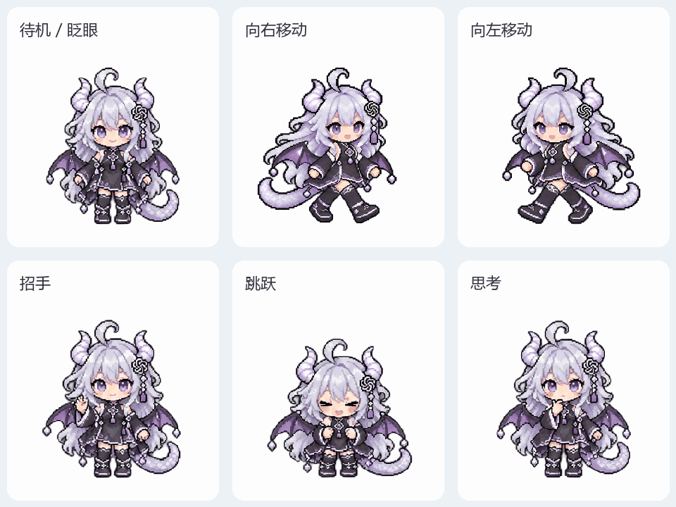

| 动作 | 用途 | 帧数 / 速度 |
| --- | --- | --- |
| 待机 | 站立、眨眼，低频播放 | 4 / 2 fps |
| 向右 / 向左 | 拖动、跑向对应屏幕边缘 | 各 4 / 4 fps |
| 招手 | 空闲达到设置间隔后招呼 | 4 / 4 fps |
| 跳跃 | 上方通知时播放，接触气泡时顶起 | 4 / 7 fps |
| 思考 | 任务进行、桌宠发送后持续循环 | 4 / 3 fps |
| 失败 / 等待 / 收尾 | 本版没有另画 | 复用待机 |

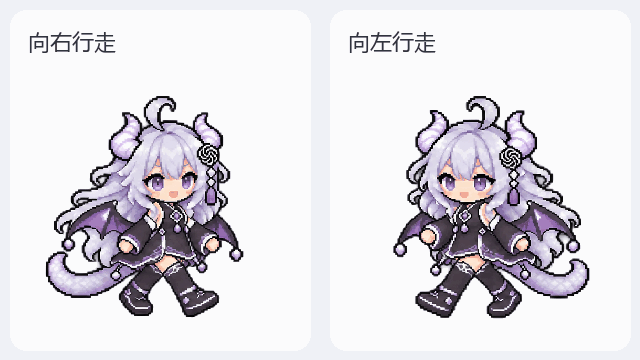

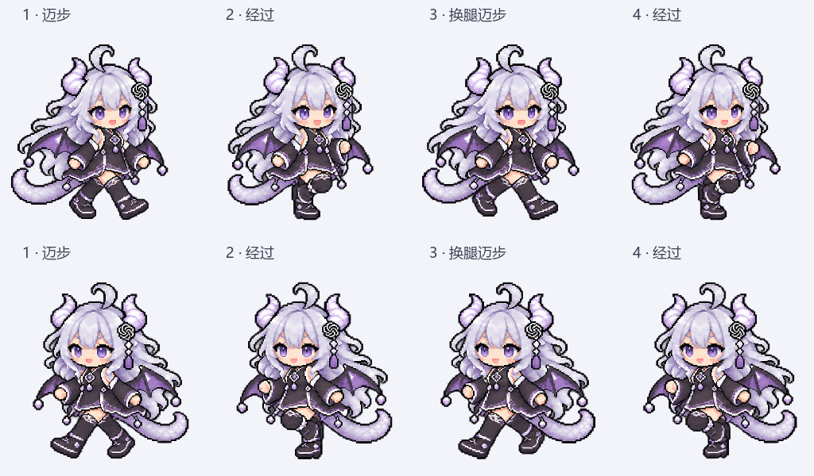

慢速图用来观察腿部交换，运行使用正常速度。通知使用原生跳跃三轮；下方通知不触发顶气泡跳跃。别人的角色没有跳跃时自动模拟。

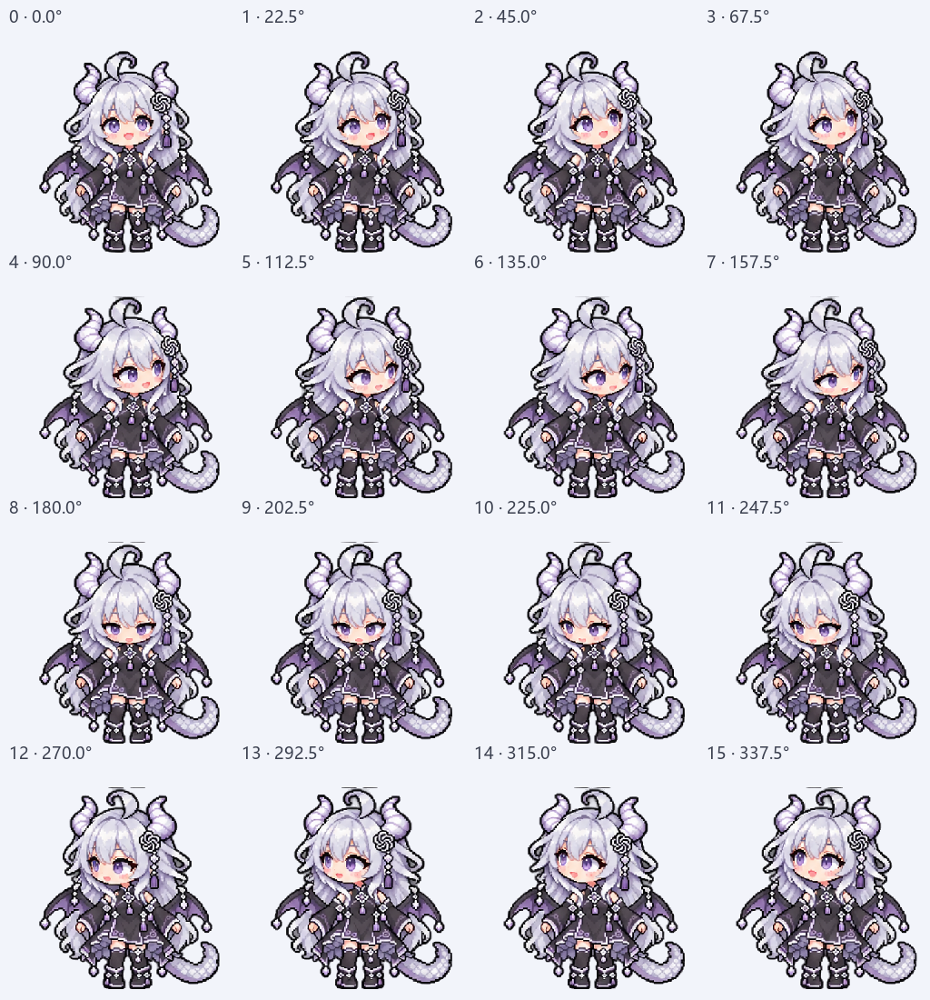

从正上方开始顺时针，每 22.5° 一格；邻近方向差别较小。注视用于桌宠自己的输入框，不监视所有软件中的文字输入。

## 工具条、额度、思考、输入和贴边

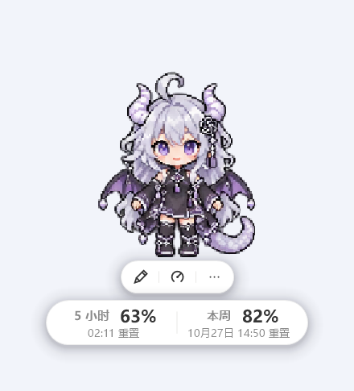

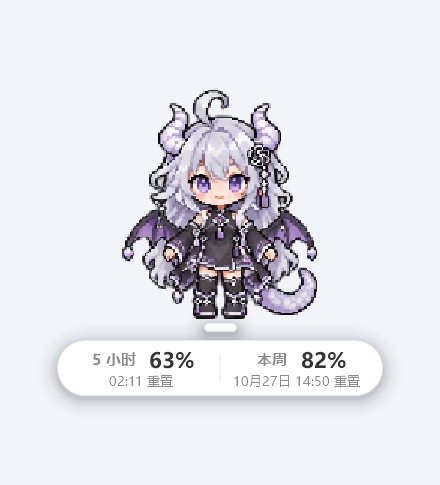

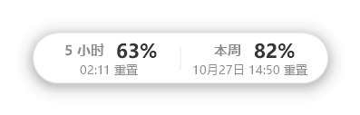

靠近左右屏幕边缘时，完整额度可自动变为一个竖向胶囊，中间用水平线分隔；回到宽敞位置恢复横排。横竖的文字、宽高、整体偏移分别保存。详见[额度排版与聊天目标](QUOTA-LAYOUT.zh-CN.md)。

工具条收起时贴近脚边，悬停人物展开。完整额度关闭后仍可启用极简悬停胶囊。额度布局跟随工具条收起／展开。排版参考作者调好的样式：325×55 基础胶囊、12.5 pt 粗体数字、分栏标签和较小的重置时间；全部仍可手调。

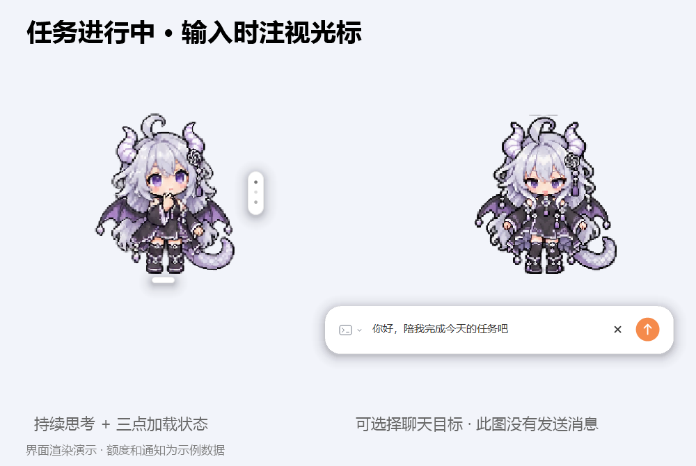

任务时持续思考并显示三点，可改大小、位置或直接拖动。发送按钮在输入文字后点亮；演示没有发送消息。Codex 目标运行独立临时会话；普通 ChatGPT 目标只带到桌面草稿，仍需在桌面点击发送，回复也在桌面查看。

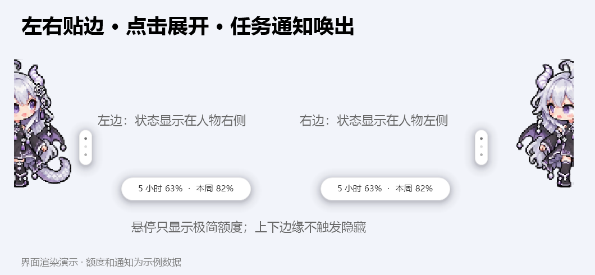

只在左右收起，上下边缘不隐藏。悬停仅显示额度，点击才展开。左侧贴边将三点放右边，右侧放左边；有通知可唤出人物。贴边保持探头姿态。

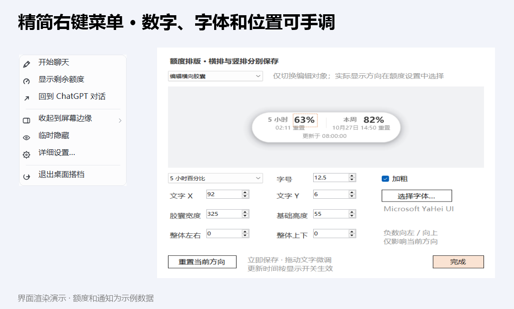

精简菜单保留日常入口。右键临时隐藏后，从托盘图标恢复。Ctrl + 滚轮缩放，拖动人物换位置。前台应用全屏时可自动避让，随 ChatGPT 启动和跟随窗口均可选。正常人物不占常规任务栏窗口；离线预览同样隐藏任务栏图标，仅开发时显式加 --qa-window 才显示。

## 五种提醒

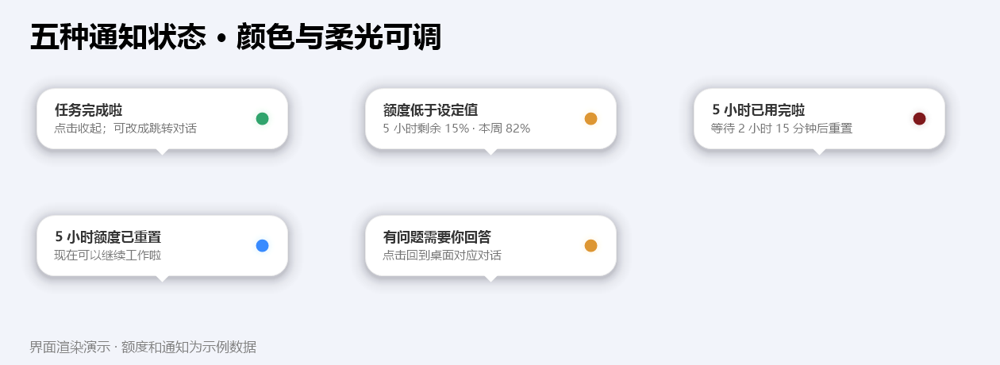

| 状态 | 默认色 | 规则 |
| --- | --- | --- |
| 完成 | 绿 | 确认完成后提醒；普通聊天默认关闭 |
| 低于阈值 | 橙 | 已结束任务后读取额度，低于所设阈值才提醒 |
| 耗尽 | 暗酒红 `#7f181b` | 说明已用完与重置时间 |
| 5 小时重置 | 蓝 | 检测到新周期，提醒一次 |
| 需要回答 | 橙 | 收到可识别的结构化请求时提醒 |

气泡从小圆形展开并回弹。完成／额度气泡保留到点击，可选择仅收起或收起并跳转；提问仍保留回桌面对话。上方空间不足时改放下方，避开工具条与额度。颜色、柔光、上下偏移均可调。

任务结束后，可按设定的阈值提醒剩余额度；额度耗尽时显示重置时间。云端异步提问的识别范围取决于桌面组件提供的状态。

## 十二个设置页

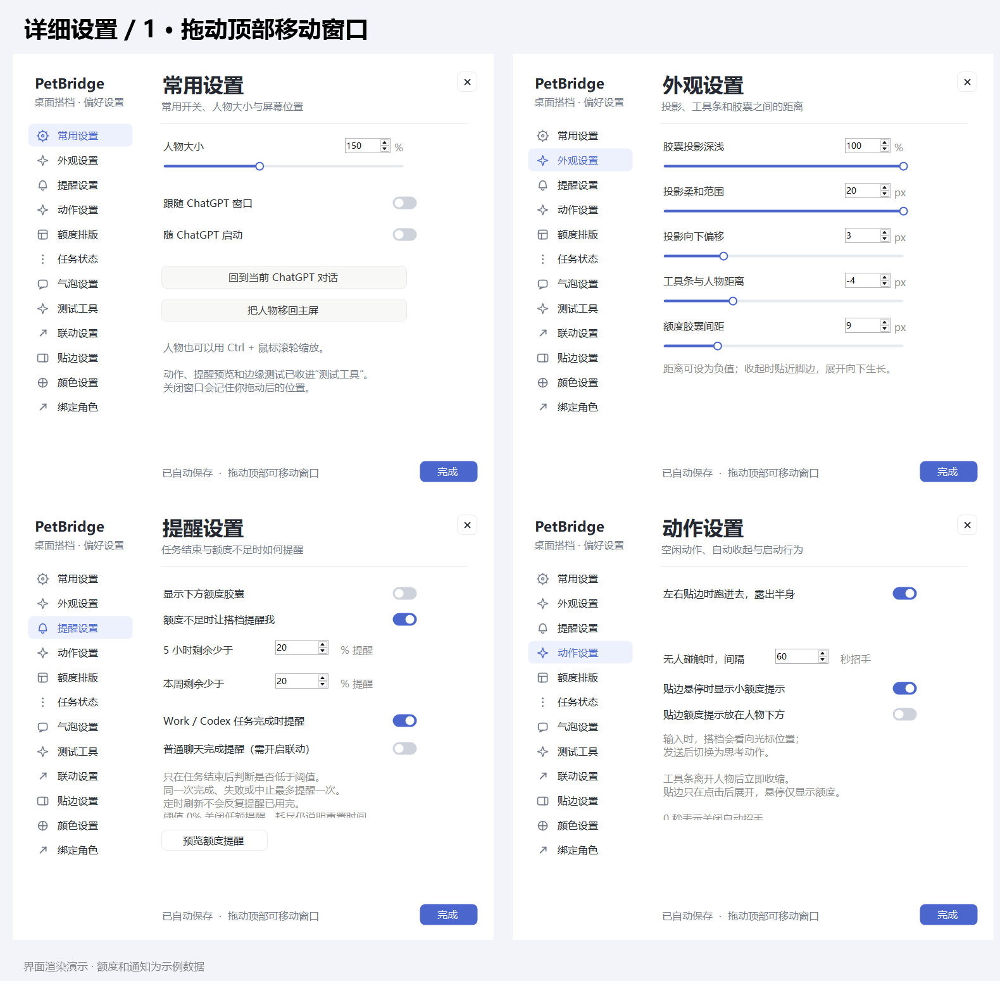

常用：大小、跟随、启动、移回主屏。外观：投影深浅／范围／偏移、工具条与额度间距。提醒：完整额度、5 小时／周阈值、普通聊天和 Work / Codex 独立开关。动作：左右收起、空闲招手、悬停额度。

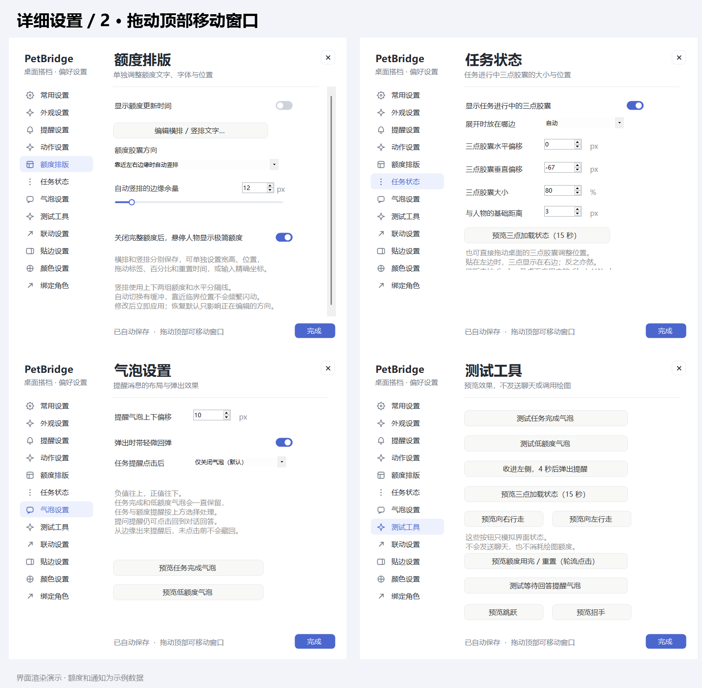

排版：每段文字的 X / Y、字号、字体、加粗、胶囊宽高、更新时间。状态：三点方向、大小、偏移和间距。气泡：位置、回弹和点击行为。测试：完成、低额、用完／重置、问题、边缘唤出、思考、跳跃、招手、左右行走；不发聊天。

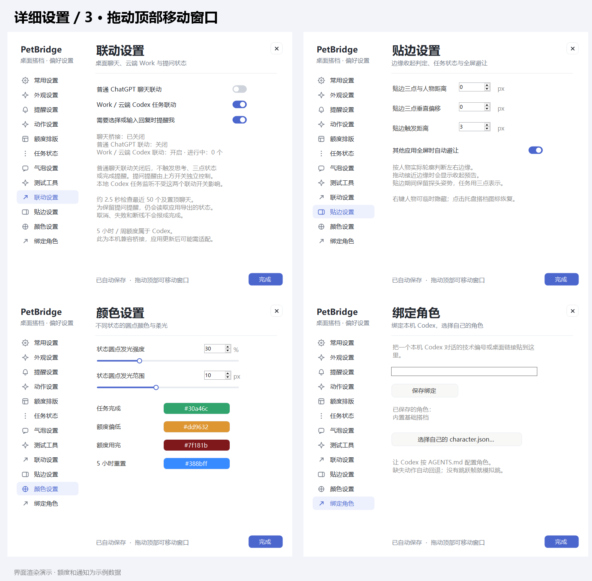

联动：桥接、问题提醒和状态说明。贴边：触发距离、三点间距与垂直位置、全屏避让。颜色：各状态和发光。绑定：本机真实 Codex 编号、自己的角色。设置顶部可拖动，关闭后记住位置。

## 绑定自己的环境

先看默认角色和离线测试，再按 [本机适配](CODEX-ADAPT.zh-CN.md) 检查。作者会话编号、账号数据与私人角色不随包提供。想换形象，用 [让 Codex 帮你改角色](CUSTOMIZE-CHARACTER.zh-CN.md) 的提示词。

用 `scripts/Export-Demos.ps1 -Output docs/media` 重现界面图；`tools/render_character_preview.py` 重现动作预览。界面演示不触发聊天、导航或真实任务事件。
