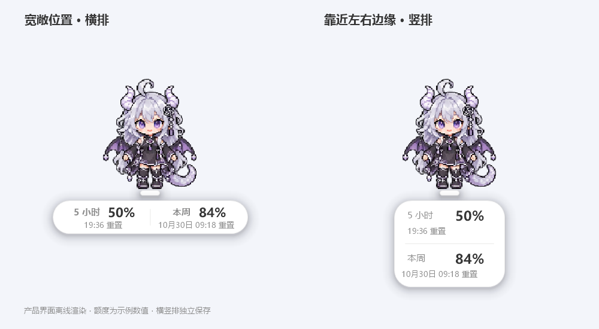

# 额度横竖排与聊天目标

## 自动竖排

在「详细设置 → 额度排版」选择「靠近左右边缘时自动竖排」。判断依据是横排胶囊是否会挤到当前屏幕边缘；回到中间后恢复横排，并保留 24 px 回切缓冲，减少临界位置反复切换。

竖排是一个圆角胶囊：上面显示 5 小时，下面显示本周，中间为水平分隔线。人物完全藏到屏幕边缘时，继续使用原来的悬停极简提示。

## 两套排版分别调整

点击「编辑横排 / 竖排文字」，先在编辑器上方选择编辑方向。此选择仅影响正在编辑的对象；桌面实际方向由额度设置页的自动／始终横排／始终竖排决定。

可以直接拖动标签、百分比、重置时间和更新时间，也可单独设置 XY、字体、字号、加粗、宽度、高度、整体左右与上下偏移。「重置当前方向」只重置当前选中的那一套。关闭「显示额度更新时间」会隐藏实际显示中的更新时间，编辑器仍保留这一行方便调整。

旧版 QuotaLayout 原样保留为横排，新增 VerticalQuotaLayout 存竖排；QuotaLayoutMode 和 QuotaEdgeMargin 控制切换。两个 Items 数组独立，修改一套不会更改另一套。

## 聊天框发给谁

点击输入框左侧的模式图标：

- **Codex · 桌宠内回复**：维持独立的本地 Codex 会话，答案在桌宠回复窗显示。
- **ChatGPT 普通 · 桌面草稿**：点击按钮会请求桌面版打开普通聊天的待发送草稿；仍需你在桌面点击发送，回复在桌面查看。输入保留，方便复制；这一步不调用 Codex，不显示为已发送或已完成。

普通聊天草稿使用本机桌面版已确认接受的 `codex://new?mode=chat&prompt=...` 兼容深链。`mode` 依赖安装版本的处理器，不能作为稳定公开接口保证。当前接口不提供在独立桌宠中直接新建普通聊天并返回回复。若没有打开到预期模式，可用「左侧模式图标 → 聊天选项 → 复制输入内容」后在桌面普通聊天中粘贴。长文本超过深链限制会提示复制，不会截短。

官方 [Commands 文档](https://learn.chatgpt.com/docs/reference/commands) 说明 `prompt` 仅填入草稿、不会自动发送；本项目的 `mode` 路由还需检查本机版本。离线测试不会打开桌面，也不会发送真实消息。
